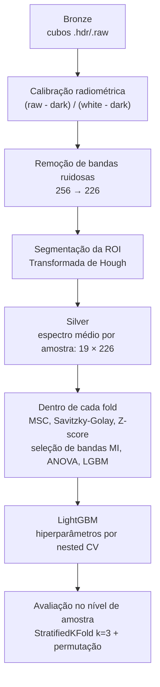
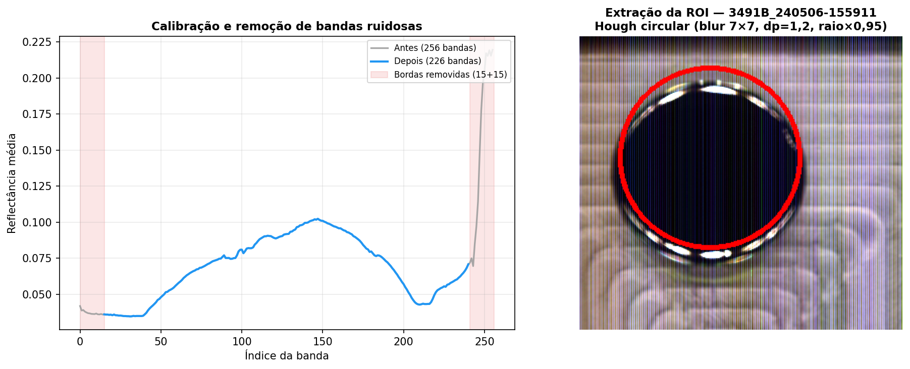
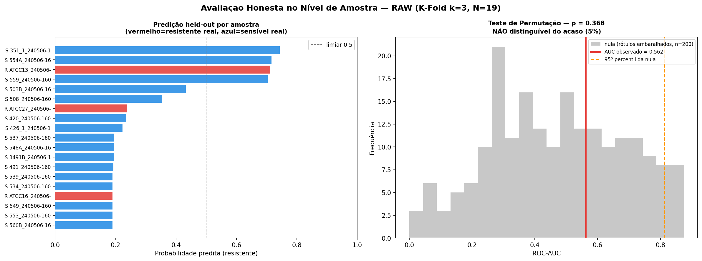

# Classificação espectral de bactérias multirresistentes com LightGBM em imagens hiperespectrais SWIR


Pipeline de pesquisa para investigar se a **imagem hiperespectral no infravermelho de ondas curtas (SWIR, 1000–2500 nm)** permite distinguir cepas de *Staphylococcus aureus* **resistentes** de cepas **sensíveis** a antimicrobianos, usando quimiometria e **LightGBM**.

Projeto de Iniciação Científica (bolsa CNPq) desenvolvido na **Pontifícia Universidade Católica de Goiás**, sob orientação do Prof. Dr. Clarimar José Coelho.

> **Resultado em uma frase:** com 19 amostras (3 resistentes) e um protocolo de validação sem vazamento de informação, o melhor modelo atingiu ROC-AUC de 0,69, e o teste de permutação **não** distinguiu o desempenho do acaso (p = 0,37). A principal contribuição é metodológica: um pipeline reprodutível, auditável e livre de *data leakage*, pronto para ser reaplicado quando houver mais amostras.

---

## Sumário

- [Motivação](#motivação)
- [Dados](#dados)
- [Pipeline](#pipeline)
- [Decisões metodológicas](#decisões-metodológicas)
- [Resultados](#resultados)
- [Limitações](#limitações)
- [Como reproduzir](#como-reproduzir)
- [Estrutura do repositório](#estrutura-do-repositório)
- [Como citar](#como-citar)

---

## Motivação

Identificar resistência antimicrobiana hoje exige cultura, antibiograma ou testes moleculares, que levam de 24 a 72 horas. A espectroscopia no SWIR é rápida, não destrutiva e sensível a diferenças químicas na composição celular. A pergunta da pesquisa é se essas diferenças são grandes o suficiente para que um modelo de aprendizado de máquina separe cepas resistentes e sensíveis a partir do espectro.

## Dados

| Item | Descrição |
|---|---|
| Amostras | 19 culturas bacterianas imageadas em uma única sessão (2024-05-06) |
| Classes | 16 sensíveis (isolados clínicos) · 3 resistentes (cepas ATCC de referência) |
| Sensor | Câmera hiperespectral SWIR, cubos `.hdr/.raw` com referências de branco e escuro |
| Bandas | 256 originais → 226 após remover 15 bandas ruidosas em cada extremidade |
| Rótulos | [`data/metadata.csv`](data/metadata.csv), gerado por `src/build_metadata.py` e revisável à mão |

As imagens brutas pertencem ao laboratório e **não são distribuídas** neste repositório. Elas podem ser solicitadas ao autor para fins acadêmicos. O pipeline espera os cubos em `data/bronze level/hsi_original/<amostra>/capture/`.

## Pipeline

Organizado em camadas no padrão medalhão (bronze → silver → gold):



| Etapa | Onde | O que faz |
|---|---|---|
| Ingestão e calibração | `src/load_data.py` | Converte contagens digitais em refletância usando as referências de branco e escuro |
| Remoção de bandas | `src/remover_bandas.py` | Corta as extremidades do espectro com baixa relação sinal-ruído |
| Segmentação | `src/rois.py` | Detecta o contorno circular da amostra (Hough) com margem de segurança |
| Pré-processamento | `src/preprocessing.py` | MSC, 1ª derivada de Savitzky-Golay e Z-score como *transformers* do scikit-learn |
| Seleção de bandas | `src/feature_selectors.py` | Rankings por Mutual Information, ANOVA e importância do LightGBM, com consenso |
| Atributos derivados | `src/feature_engineering.py` | Estatísticas espectrais, derivadas e índices |
| Modelagem | `src/modeling_roi.py` | Matriz por amostra, validação cruzada, nested CV e teste de permutação |
| Orquestração | `run_all.py` | Executa a cadeia completa e salva tudo em `runs/<timestamp>/` |

## Decisões metodológicas

Com N pequeno, a forma de validar pesa mais que a escolha do modelo. Estas foram as decisões centrais:

1. **Unidade de análise = amostra, não pixel.** Uma versão inicial tratava cada pixel como observação (~400 mil linhas). Pixels da mesma placa são altamente correlacionados, o que gera **pseudo-replicação** e infla as métricas. O modelo final usa um espectro médio por amostra (matriz 19 × 226).
2. **Tudo que aprende com dados fica dentro do fold.** Pré-processamento, seleção de bandas e ajuste de hiperparâmetros são ajustados apenas no treino de cada partição, sem *data leakage*.
3. **StratifiedKFold k=3 em vez de Leave-One-Out.** Com classes tão desbalanceadas, o LOO vaza o rótulo pela mudança de prevalência no treino: em testes, ele chegou a AUC = 1,0 até com rótulos embaralhados. A estratificação mantém a prevalência constante.
4. **Nested CV para hiperparâmetros** (externo k=3, interno k=2), para que a métrica final não seja usada na escolha dos parâmetros.
5. **Teste de permutação (200 permutações)** para obter um p-valor honesto de que o desempenho é diferente do acaso.
6. **Rótulos auditáveis.** O rótulo vem de um arquivo de metadados versionado, e não de uma regra embutida no código baseada no nome do arquivo.

## Resultados

Execução de referência: [`runs/20260711_160137/`](runs/20260711_160137/SUMMARY.md). Métricas sobre as 19 predições *held-out*:

| Pré-processamento | Seleção de bandas | F1 | Recall (resistente) | ROC-AUC |
|---|---|---|---|---|
| MSC | MI, k=15 | 0,250 | 0,333 | **0,688** |
| RAW | todas + atributos derivados | 0,286 | 0,333 | 0,562 |
| Savitzky-Golay | todas + atributos derivados | 0,267 | 0,667 | 0,521 |
| Z-score | MI, k=15 | 0,267 | 0,667 | 0,521 |

**Teste de permutação (RAW):** AUC observada = 0,562, p = 0,368 com 200 permutações. O desempenho **não é estatisticamente distinguível do acaso**.

<p align="center">
  
</p>
<p align="center">
  
</p>

Todas as figuras da execução estão em [`runs/20260711_160137/figuras/`](runs/20260711_160137/figuras/).

## Limitações

- **Tamanho amostral:** 19 amostras e apenas 3 da classe positiva limitam qualquer conclusão estatística.
- **Confundimento:** as 3 amostras resistentes são justamente as cepas ATCC de referência e foram as últimas imageadas na sessão. Assim, o modelo pode estar aprendendo diferenças de cepa ou de ordem de aquisição, e não de resistência. Esse confundimento está documentado em `src/build_metadata.py` e no notebook 08.
- **Rótulos provisórios:** em `data/metadata.csv` os rótulos foram atribuídos pela regra cepa ATCC = resistente (`fonte_rotulo = heuristica_ATCC_VERIFICAR`) e ainda devem ser conferidos contra os laudos microbiológicos.
- **Sessão única:** não há réplicas biológicas nem aquisições em dias diferentes para avaliar variação entre sessões.

O próximo passo natural é ampliar o conjunto com isolados clínicos resistentes e várias sessões de aquisição. Essa linha continua em um projeto com redes neurais profundas.

## Como reproduzir

Requer Python 3.13 e os cubos hiperespectrais na camada bronze.

```bash
python -m venv .venv
source .venv/bin/activate          # Windows: .venv\Scripts\activate
pip install -r requirements.txt

python src/build_metadata.py       # gera/atualiza data/metadata.csv
python run_all.py --upstream       # bronze -> silver + notebooks de modelagem
python run_all.py --upstream --fresh --html   # tudo do zero, com HTML dos notebooks
```

Cada execução cria `runs/<timestamp>/` com log, `SUMMARY.md`, figuras, JSONs e, opcionalmente, os notebooks em HTML.

### Notebooks

| Notebook | Conteúdo |
|---|---|
| `01_raw_visual_inspection` | Inspeção visual dos cubos brutos |
| `02_band_removal_analysis` | Análise de ruído e corte de bandas |
| `03_roi_validation` | Validação da segmentação por Hough |
| `04_preprocessing_effects` | Efeito de MSC, Savitzky-Golay e Z-score nos espectros |
| `05_baseline_model_analysis` | Baseline pixel a pixel (histórico, superado) |
| `06_feature_selection_k15` | 20 combinações de seleção de bandas × pré-processamento |
| `07_hyperparameter_tuning` | Nested CV no nível de amostra |
| `08_modelo_final` | Avaliação final, matrizes de confusão e teste de permutação |

## Estrutura do repositório

```
.
├── data/
│   ├── metadata.csv              # rótulos e metadados das 19 amostras
│   ├── bronze level/             # cubos brutos (não versionados)
│   ├── silver level/             # dados calibrados e ROIs (gerados)
│   └── gold level/               # atributos para modelagem (gerados)
├── notebooks/                    # 01–08: exploração, validação e modelagem
├── runs/20260711_160137/         # execução de referência (figuras, logs, métricas)
├── src/                          # módulos do pipeline
├── pipeline_completa.py          # bronze -> silver
├── run_all.py                    # orquestrador ponta a ponta
├── reset_folders.py              # limpa as camadas geradas
├── requirements.txt
└── CITATION.cff
```

## Como citar

Se este trabalho ou o código forem úteis para a sua pesquisa, cite:

> GOMES, Arthur Oliveira. **Classificação espectral de bactérias multirresistentes com LightGBM em imagens hiperespectrais SWIR.** Iniciação Científica (CNPq), Pontifícia Universidade Católica de Goiás, Goiânia, 2026. Orientador: Clarimar José Coelho. Disponível em: https://github.com/Athurgomes/IC-LightGBM.

```bibtex
@misc{gomes2026hsilightgbm,
  author       = {Gomes, Arthur Oliveira},
  title        = {Classificação espectral de bactérias multirresistentes com {LightGBM} em imagens hiperespectrais {SWIR}},
  year         = {2026},
  howpublished = {\url{https://github.com/Athurgomes/IC-LightGBM}},
  note         = {Iniciação Científica (CNPq), Pontifícia Universidade Católica de Goiás. Orientador: Clarimar José Coelho}
}
```

O GitHub também gera a citação automaticamente pelo botão **"Cite this repository"**, a partir do [`CITATION.cff`](CITATION.cff).

## Agradecimentos

Ao Conselho Nacional de Desenvolvimento Científico e Tecnológico (**CNPq**) pela bolsa de Iniciação Científica e à **PUC Goiás** pela infraestrutura e pelas amostras.
